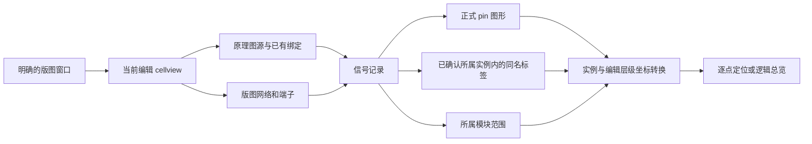

# 实现结构与扩展

## 0.3.5 统计与精简筛选

`lsnStatistics()` 按全局记录中的标量行分别汇总原理图 Pin / 其他 Nets，排除总线聚合；只读取已有缓存和修改计数。当前有效 Connected 决定完成数与比例；Open、Unverified 使用独立标记，未检查、过期及无完成依据的其他结果归 Pending。统计不调用物理检查、不写缓存、不改变选择。

`lsnFilter()` 使用同一次计数快照更新列表与 `lsnUpdateStatistics()`，Check selected 和队列的既有刷新路径因此同步更新统计。Show 仅保留 All / Pin / Nets / Pin Open / Net Open / Unverified；两类 Open 以原理图 Pin 身份与 Open 标记相交，不根据最后一列的文字前缀猜测。最后一列仍保留全部详细状态。

## 0.3.4 PAD 义务、绑定与证明

`lsnpApplyPad()` 对单个位的原理图 Pin 将内部结果与外部 PAD 义务分开；只有所有核心端点和必需 PAD 核心目标得到物理证明才添加 Connected。UNPLACED_IO 只是没有独立小 pin 的提示，可由已验证的实际 PAD 目标满足，不能强制多建一个无必要的 layout pin。普通内部 Nets 不经过此完成条件。

PAD inventory 按明确 profile 和专用库定义扫描 master 图，反向传播含 PAD 的 master 标记，再展开必要 occurrence；不逐个展开全部数字标准单元。每次扫描有 master/edge/occurrence 限制，未知专用 PAD 单元和未知阵列不当作空白。普通设计库里注册一个自定义 PAD，不会把整库都判为 PAD。

目标有准确实例路径、核心端子、接入候选、必需目标分组。端子内多个图形按 OR，多个必需目标按 AND；显式目标与可靠自动目标取并集，不允许覆盖其他已知逻辑义务。GPIO 只查核心端子，不能依靠金属直接追到其外部 PAD。默认模拟 PAD 使用实际 BOND 对应导体，GPIO 使用真实端子或标签落脚。

PAD 在上级时，核心位置换算到选定 occurrence 的装配坐标，联合追踪得到核心/目标分组，再将结果与原核心导航位置关联。PAD 点保存所属窗口，逐点、总览和 Back 使用正确窗口。配置保存稳定库/单元/视图和路径，不保存会话 dbId；profile/每网绑定签名参与该 Pin 的新鲜度检查，不清空其他网缓存。

PAD 设置窗由主导航器拥有，关闭导航或改变核心上下文会取消该设置窗，不关闭任何设计窗口。全部运行查询仍只读，唯一的持久配置写入是用户显式 Save config。

0.3.3：`lsnIsSchematicPin(record)` 直接查关联原理图的顶层 terminal 索引，包含总线各位和聚合记录。Pin 不依赖连接缓存、版图 pin 图形或模块 instTerm，Nets 为其补集。Show 移除旧 Ports/Pin not placed/Physical pin 分支；这些内部物理状态标记可以继续支持详细信息，但不作为用户的 Pin 分类。

## 0.3.2 缓存与筛选

`lsncStamp()` 仅描述绑定窗口、版图、原理图及追踪配置，不再包含全部打开 cellview 的清单和计数。旧实现会因追踪加载了额外 master 而清空整表。`lsncCheckRecord()` 现在只赋值 `cache[name]`，每条记录保存自己的 `counters`。`lsncEntryCurrent()` 对比原有快照中的对象，新增打开的单元不会使旧记录过期；已有对象计数变化或关闭时保留记录并显示 needs recheck。

`lsncCounterMap()` 为一次表格更新建立只读计数表，供各记录比较，避免逐行重复读取数据库。这个快照是保守的，可能包含不属于该网络的其他已打开单元；其变化可以要求重查，但不清空原结论。检查期间的计数保护仍然保留，不能把真正编辑中的追踪结果认作可靠完成。

`lsncClassify()` 写入独立的 `tags`，例如 Open、Unverified、Pin not placed 可以并存。`lsncMatchesFilter()` 按记录类型/标记/新鲜度判断，`lsncColumn()` 生成显示文本；筛选不解析最后一列文字，不调用追踪，不改变网络选择。Bus 是可按记录类型识别的聚合类别。Refresh、重新加载或真实上下文/配置切换仍会重建缓存。

## 0.3.1 导航分支补充

本版继续使用单文件运行模型，已在文件后部合入原理图索引和物理连接模块；不加载 0.4 的预测面板或 Python worker。

`lsnSourceIndex()` 扫描原理图 terminal 和 instTerm，将端口名与实际连接网表达式分别经 `dbProduceMemName` 按声明顺序展开并配对，修复只挂在聚合总线上的端口漏识别。宽度不匹配不猜索引；`basic/noConn` 不作为物理端点。

位置记录前七项保持兼容，新增 `direction origin logicalNetName`。方向依据为 schematic 或 layout。missing 扩展为 `(name reason category direction)`，UNPLACED_IO 与其他物理未知分开。

`lsnFindLanding()` 从标签锚点作层级真实相交查询，`lsnHitGeometry()` 累积普通实例/via 变换；未知阵列路径不猜测。顶层源 I/O 无正式 pin 时可查同名标签，位置仍是 LABEL。`lsnc*` 以临时 physical trace 容器分组，按修改计数失效，只清理本模块新建 ID。

表格和 Next 的最终实现位于单文件后部；不要只改前面的基础定义。每次完整加载时 `lsncBaseNext` 捕获本文件刚定义的基础 lsnNext，避免旧包装函数递归。

## 单文件运行模型

`src/signal_navigator.il` 是唯一的必需运行文件。它包含 UI、配置、只读查询、坐标转换、显示标记和独立配色定义。加载仅注册函数和默认配置；`lsnStart()` 才创建面板。

所有函数及全局数据使用 lsn 前缀。一个 Virtuoso 进程内只有一份活动状态，核心表为 `lsnState`、配置表为 `lsnConfig`。这里的 SKILL 指 Cadence 脚本语言，不是其他产品的插件格式。



## 信号与位置记录

信号记录由名称、分类、可选的源 net、来源文字组成。名称用于表格选择，不使用图形对象“当前选中项”作为隐式后续目标。

位置记录为列表：

```lisp
(displayName point bbox layer kind status ownerPrefix)
```

kind 是 PORT、PIN、LABEL、INSTANCE 之一。正式 pin 的位置来自 pin 图形；LABEL 来自文字锚点；INSTANCE 仅代表模块范围。`missing` 单独记录不能提供坐标的源端点。

较精确的正式 pin 会覆盖同一 ownerPrefix 的粗略线索；找到标签后也会移除重复模块范围线索。一个 terminal 的多个图形可以有多个位置，因此“位置数”不等于“逻辑端子数”。

## 绑定与回退

`lsnResolveSource()` 使用显式 sourceOverride，或可用的 `lxGetSchematic()`。`lsnBound()` 包装可选的 `bndGetBoundObjects()`，将其不同嵌套返回形式展开后按对象类型及所属 cellview 筛选。

版图网络已有的 terms/instTerms 是第一条查询路径。源端点的已有绑定是第二条路径，用于补充网络传播信息不完整时仍可定位的实例 pin 或标签。

标签只在已经对应到的实例 master 内查找。可配置同名 net 回退，但没有全芯片同名 instance 猜测，也不调用创建绑定、更新源、保存设计或重建连接的 API。

## 坐标

master 中的 pin bbox 经 `dbTransformBBox()` 转到当前编辑 cellview；label 的 xy 经 `dbTransformPoint()` 转换。再用 `geEditToWindowPoint()` 转到当前显示窗口的坐标。

标签优先采用锚点，避免文字长短影响导航。模块实例 bbox 已经在编辑 cellview 坐标系中，不重复施加实例变换。

## UI 与生命周期

Report field 的选择索引对应其 choices 数据，排序不会改变记录身份。内部更新表格时用 busy 标记和禁用通知的选择调用，避免回调再次触发自身。

窗口和编辑 cellview 被明确保存在状态中。上下文变化时要求重新绑定；多个无当前目标的窗口不随机选择。窗口切换时只重建自己的 dock/form，不关闭设计窗口。

`lsnClose()` 清除本插件拥有的高亮集并关闭自己的面板。函数定义及已注册的临时配色资源保留至会话结束。

## 配色与文件写入

脚本的核心查询路径不写设计数据库。配色初始化把原创 DRF 定义写入一个唯一临时文件，用 `drLoadDrf()` 注册后，在 unwindProtect 清理阶段删除这一文件。异常和中断也尝试关闭句柄和删除该文件。

此路径不复制、修改或覆盖用户的显示文件。资源名均有 lsn 前缀。初始化失败时使用当前高亮层并在 CIW 说明降级。

## 缓存与性能

标签名称索引按 master 缓存，原名和括号兼容名分别索引。读取时过滤失效对象及已经不匹配的名称。Refresh 会重建索引。

逐点操作重新读取实际坐标；不预先递归导出整片的所有金属。总览只连接 N−1 条逻辑线，邻近链算法在配置阈值内执行，超限后采用线性星形示意。金属包围框和文字数量有独立上限。

## 扩展建议

可独立替换 `lsnResolveSource()`、`lsnBound()` 或标签层映射以适配具体环境。增加新的定位依据时，应同时明确 kind/status、坐标系、置信边界、总览样式及测试，避免把模糊候选伪装为正式 pin。

全层次网络遍历、mosaic 索引、复杂多对多设备对应、事件驱动刷新和多面板状态都需要单独设计，不应通过取消当前边界检查来模拟支持。
